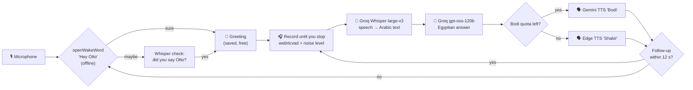

<div align="center">

# 🤖 Otto Cloud

### A free, fast voice assistant that speaks natural Egyptian Arabic

Say **"Hey Otto"** and just talk. Otto understands Egyptian Arabic, answers briefly and honestly,<br>
and replies in a natural Egyptian voice. It runs on a normal Windows laptop with no GPU, using free cloud APIs.


-2ea44f)


**Built at [Smart Technology](#-about) to help kids and youth learn and explore.**

🔌 Want a fully offline version that runs on your own GPU? → **[Otto-Assistant](https://github.com/Amr-Ebrahim/Otto-Assistant)**

</div>

---

## ✨ Features

- 🎙️ **"Hey Otto" wake word.** It listens offline on your laptop, then double-checks with Whisper so it doesn't wake by mistake.
- 💬 **Conversation mode.** After waking, keep asking follow-up questions with no wake word. Otto goes back to sleep after 12 s of silence.
- 🇪🇬 **Real Egyptian Arabic.** It understands your dialect and answers in it, not in formal Arabic.
- 🗣️ **Natural Egyptian voice.** It uses Gemini's **"Bodi"** voice, streamed so it starts talking as soon as the first audio arrives.
- 🔁 **Automatic backup voice.** When Bodi's free daily limit runs out, it switches to Microsoft Edge's Egyptian voice **"Shakir"** without stopping.
- 🧠 **Honest answers.** It says *"والله مش متأكد"* ("honestly, I'm not sure") instead of making facts up. It asks you to repeat when a question was misheard, and it knows it has no live weather or news.
- 🕐 **Knows the date and time**, and tells the time the Egyptian way ("2:41 بعد الضهر", "2:41 in the afternoon").
- 🧒 **Kid-friendly.** It speaks simply, encourages learning, and points to a parent for unsuitable topics.
- 🔇 **Ignores silence and noise.** It measures your room's noise level and uses voice detection, so it never sends empty audio to the cloud.
- 💸 **$0 to run.** It uses only free tiers, with no credit card. An optional paid upgrade costs about $1.5–5/month.

---

## 🔄 How it works



| Stage | What runs | Where |
|---|---|---|
| Wake word | openWakeWord + custom `hey_otto.onnx` | 💻 your laptop |
| End-of-speech detection | webrtcvad + noise calibration | 💻 your laptop |
| Speech-to-text | Whisper large-v3 (`language="ar"`) | ☁️ Groq |
| Brain | gpt-oss-120b, medium reasoning | ☁️ Groq |
| Voice | Gemini 3.8 Flash TTS, voice **Bodi** (`ar-EG`) | ☁️ Google |
| Backup voice | Edge TTS `ar-EG-ShakirNeural` | ☁️ Microsoft |

### ⏱️ Speed (measured)

| Step | Time |
|---|---|
| Understanding you (Whisper) | ~0.6–1.1 s |
| Thinking of an answer | ~0.5–1.1 s |
| **Voice starts after you stop talking** | **~4–5 s** (most of it is the TTS starting up) |

---

## 🆓 What the free plan gives you per day

| Part | Free limit | In practice |
|---|---|---|
| 🎤 Speech-to-text (Groq Whisper) | 2,000 requests | ~2,000 questions, never the bottleneck |
| 🧠 Brain (Groq gpt-oss-120b) | 1,000 requests / 200K tokens | **~80–130 answers**, the real limit |
| 🗣️ Bodi voice (Gemini TTS) | 10 requests, 3 per minute | **10 answers** (~1–2 min of speech) |
| 🗣️ Shakir voice (Edge TTS) | no official limit | everything after Bodi's 10 |

In short, each day you get **~10 answers in Bodi's voice, then ~70–120 more in Shakir's**, which is about 25–35 minutes of real conversation.
Bodi's limit resets at midnight Pacific time (10:00 Cairo time in summer, 11:00 in winter).

> Free-tier limits are set by each provider and can change at any time.

### 💳 Optional: Bodi for every answer
Turn on billing in Google AI Studio (Tier 1), then raise `GEMINI_TTS_RPD` / `GEMINI_TTS_RPM` in `.env` to your new limits.
Bodi costs about **$0.0135 per minute of speech** (launch price until 31 Dec 2026, then about $0.027), which is roughly **$0.002 per answer**:

| Usage | Until Dec 2026 | From 2027 |
|---|---|---|
| 30 answers / day | ~$1.5 / month | ~$3 / month |
| 100 answers / day | ~$5 / month | ~$10 / month |

Set a budget alert in Google Cloud Billing so you never get surprised.

---

## 🚀 Setup (Windows)

### 1. Get the requirements
- **Python 3.11 (64-bit)** from [python.org](https://www.python.org/downloads/). Newer versions are too new for some libraries.
- A **microphone** (a USB mic works best) and **headphones**, so Otto doesn't hear himself.
- Two free API keys:
  - **Groq** → [console.groq.com/keys](https://console.groq.com/keys)
  - **Google AI Studio** → [aistudio.google.com/apikey](https://aistudio.google.com/apikey) (new keys start with `AQ.`, which is normal)

### 2. Download and install
```bat
git clone https://github.com/Amr-Ebrahim/Otto-Cloud.git
cd Otto-Cloud
setup.bat
```
`setup.bat` creates a virtual environment, installs everything, downloads openWakeWord's helper models and creates your `.env`.

### 3. Add your keys
Open `.env` in Notepad and fill in:
```ini
GROQ_API_KEY=gsk_...
GEMINI_API_KEY=AQ....
```
> 🔒 Keep your keys **only** in `.env`. It is in `.gitignore`, so it never gets uploaded.

### 4. Pick your microphone (recommended)
```bat
.venv\Scripts\activate
python tools\find_mic.py
```
Say the same sentence into each mic, then put the number of the clearest one in `.env`, e.g. `INPUT_DEVICE=20`.
*Tip: the WASAPI version of a USB mic usually gives the cleanest audio.*

### 5. Check everything
```bat
python tools\check_setup.py
```
Everything should say **OK**. This check doesn't use any of your free voice answers.

### 6. Run Otto 🎉
Double-click **`start_otto.bat`**, stay quiet for 1 second while it measures the room noise, then say **"Hey Otto"**.

---

## 📁 Project structure

```
Otto-Cloud/
├── otto.py              # main loop: wake → greet → listen → think → speak → follow-ups
├── listen.py            # mic, end-of-speech detection, noise calibration, Whisper
├── voice.py             # Bodi (Gemini) + Shakir (Edge) voices, free-quota counter, cached greeting
├── wake.py              # "Hey Otto" (openWakeWord + Whisper double-check)
├── system_prompt.txt    # Otto's personality, rules and knowledge (edit me!)
├── models/
│   └── hey_otto.onnx    # custom wake-word model
├── tools/
│   ├── check_setup.py   # checks Python, libraries, keys and audio
│   ├── find_mic.py      # finds your clearest microphone
│   └── test_wake.py     # shows wake-word scores to tune WAKE_THRESHOLD
├── setup.bat            # one-time install
├── start_otto.bat       # double-click to run Otto
├── requirements.txt
└── .env.example         # copy to .env and add your keys
```

---

## ⚙️ Settings (`.env`)

| Setting | Default | What it does |
|---|---|---|
| `GROQ_API_KEY` | required | Whisper + brain |
| `GEMINI_API_KEY` | empty | Bodi's voice (empty = backup voice only) |
| `GEMINI_VOICE` | `Bodi` | Gemini voice name |
| `INPUT_DEVICE` | Windows default | microphone number from `tools\find_mic.py` |
| `GEMINI_TTS_RPD` / `GEMINI_TTS_RPM` | `10` / `3` | Bodi's limits per day / per minute |
| `EDGE_VOICE` | `ar-EG-ShakirNeural` | backup voice (`ar-EG-SalmaNeural` = female) |
| `WAKE_THRESHOLD` | `0.04` | lower = wakes more easily |

To change Otto's personality, knowledge or rules, just edit **`system_prompt.txt`**.

---

## 🛠️ Troubleshooting

| Problem | Fix |
|---|---|
| Arabic looks reversed in the terminal | That's only Windows CMD's display. `otto_log.txt` has the correct text |
| Otto doesn't wake up | Run `python tools\test_wake.py`, then lower `WAKE_THRESHOLD` a little |
| Otto hears nothing | Check the mic isn't muted, or pick another one with `tools\find_mic.py` |
| `[backup voice]` before 10 answers | You asked more than 3 questions in one minute (Bodi's per-minute limit). That's normal |
| `Terminate batch job (Y/N)?` | Shown after Ctrl+C in `start_otto.bat`. Type `Y` |
| `IndentationError` after editing | Python needs exact spaces. Re-paste the whole file instead of single lines |

---

## 🗺️ Roadmap

- [ ] Short "thinking" sound to cover the wait before Otto speaks
- [ ] Retrain `hey_otto` with more voices for more consistent wake-ups
- [ ] English conversation mode
- [ ] Optional web search for live questions (weather, news)

---

## 👥 About

**Otto** was created by **Eng. Amr Ebrahim** at **Smart Technology**, which teaches kids and youth programming, robotics and AI.
Otto is built to give them a friendly assistant they can ask about anything, in their own dialect.

- 🔌 Offline edition: [Otto-Assistant](https://github.com/Amr-Ebrahim/Otto-Assistant)
- 📄 License: [MIT](LICENSE)

<div align="center">

⭐ If you like Otto, give the repo a star!

</div>
